# Deep project pages

The shared project-detail template now renders typed metrics, monograph sections, evidence and project dossiers. The project index keeps its URL-backed filters and puts lower-priority topics under More topics.

## Screenshots

Desktop captures use 1440 px. Mobile captures use 390 px. Click a desktop preview for the full page. The reference column uses the supplied Stitch exports; the HTML references were also rendered with a local Tailwind v3 build.

| Page | Stitch reference | New page, light | New page, dark | Full mobile screenshots |
| --- | --- | --- | --- | --- |
| physics-residual-aqa | <a href="../stitch/physics_residuals_for_diving_project_detail_light/screen.png">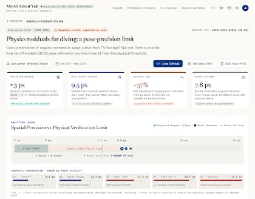</a> | <a href="screenshots/physics-residual-aqa-desktop-light.webp">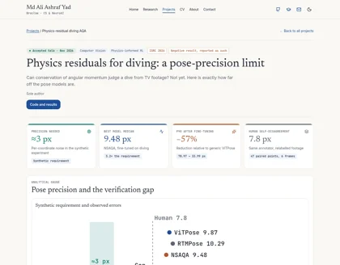</a> | <a href="screenshots/physics-residual-aqa-desktop-dark.webp">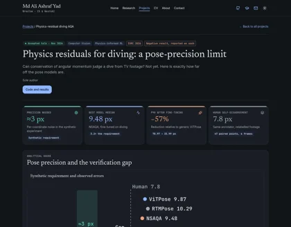</a> | [Light](screenshots/physics-residual-aqa-mobile-light.webp) · [Dark](screenshots/physics-residual-aqa-mobile-dark.webp) |
| budgetaware-hpo | <a href="../stitch/budgetaware_hpo_project_detail_light/screen.png">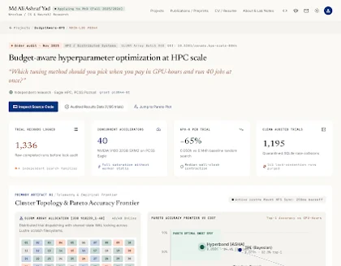</a> | <a href="screenshots/budgetaware-hpo-desktop-light.webp">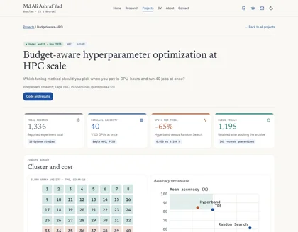</a> | <a href="screenshots/budgetaware-hpo-desktop-dark.webp">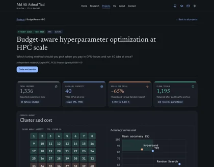</a> | [Light](screenshots/budgetaware-hpo-mobile-light.webp) · [Dark](screenshots/budgetaware-hpo-mobile-dark.webp) |
| fly-connectome | <a href="../stitch/fly_compass_connectome_project_detail_light/screen.png">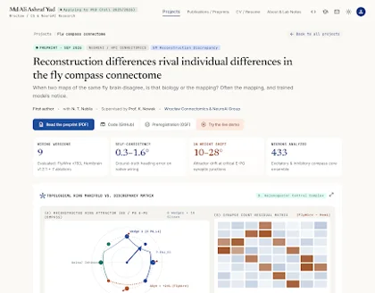</a>  [Mobile reference](../stitch/fly_compass_connectome_project_detail_mobile_light/screen.png) | <a href="screenshots/fly-connectome-desktop-light.webp">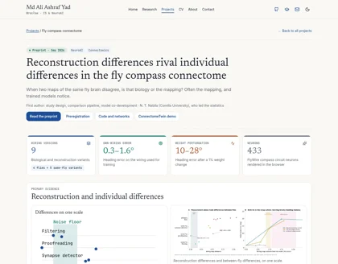</a> | <a href="screenshots/fly-connectome-desktop-dark.webp">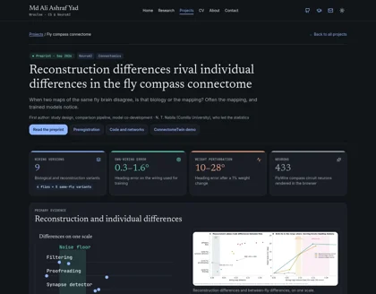</a> | [Light](screenshots/fly-connectome-mobile-light.webp) · [Dark](screenshots/fly-connectome-mobile-dark.webp) |
| connectometwin | <a href="../stitch/connectometwin_project_detail_light/screen.png">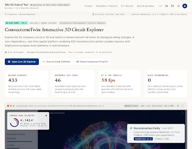</a> | <a href="screenshots/connectometwin-desktop-light.webp">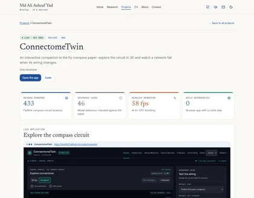</a> | <a href="screenshots/connectometwin-desktop-dark.webp">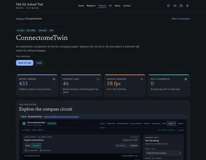</a> | [Light](screenshots/connectometwin-mobile-light.webp) · [Dark](screenshots/connectometwin-mobile-dark.webp) |
| zen-os | <a href="../stitch/zen_os_project_detail_light/screen.png">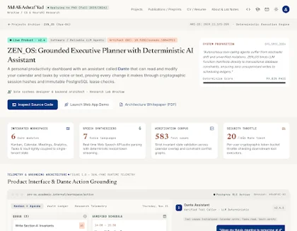</a> | <a href="screenshots/zen-os-desktop-light.webp">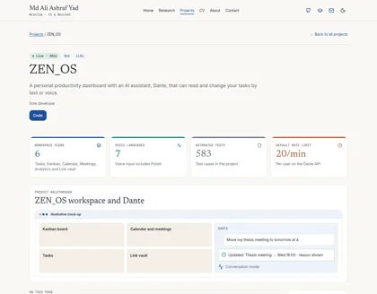</a> | <a href="screenshots/zen-os-desktop-dark.webp">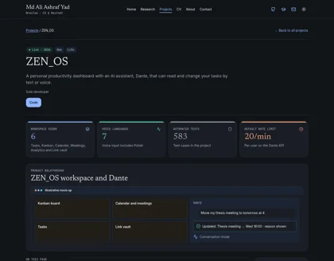</a> | [Light](screenshots/zen-os-mobile-light.webp) · [Dark](screenshots/zen-os-mobile-dark.webp) |
| trust-but-verify | No Stitch screen | <a href="screenshots/trust-but-verify-desktop-light.webp">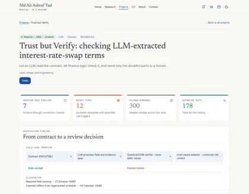</a> | <a href="screenshots/trust-but-verify-desktop-dark.webp">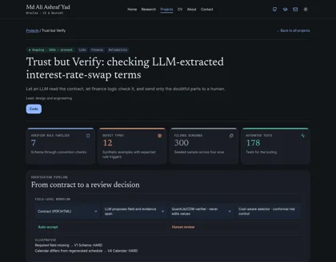</a> | [Light](screenshots/trust-but-verify-mobile-light.webp) · [Dark](screenshots/trust-but-verify-mobile-dark.webp) |
| adni-brain-age | No Stitch screen | <a href="screenshots/adni-brain-age-desktop-light.webp">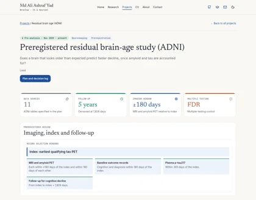</a> | <a href="screenshots/adni-brain-age-desktop-dark.webp">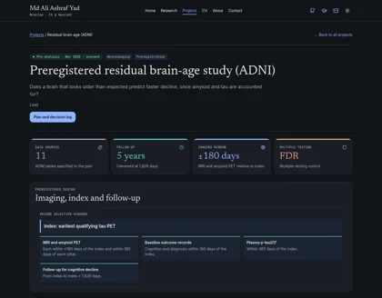</a> | [Light](screenshots/adni-brain-age-mobile-light.webp) · [Dark](screenshots/adni-brain-age-mobile-dark.webp) |
| climateguard | No Stitch screen | <a href="screenshots/climateguard-desktop-light.webp">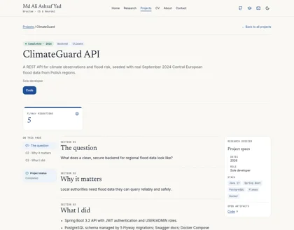</a> | <a href="screenshots/climateguard-desktop-dark.webp">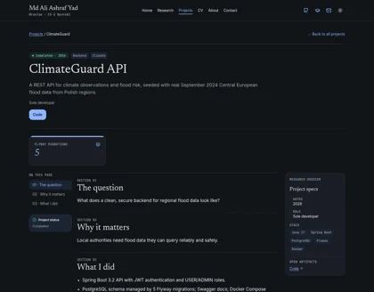</a> | [Light](screenshots/climateguard-mobile-light.webp) · [Dark](screenshots/climateguard-mobile-dark.webp) |
| index | <a href="../stitch/projects_md_ali_ashraf_yad_light/screen.png">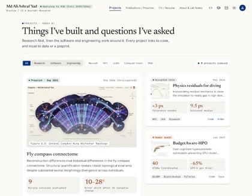</a> | <a href="screenshots/index-desktop-light.webp">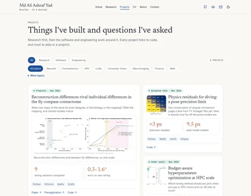</a> | <a href="screenshots/index-desktop-dark.webp">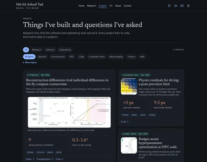</a> | [Light](screenshots/index-mobile-light.webp) · [Dark](screenshots/index-mobile-dark.webp) |

## Verification

- Lint, production build and the content guard passed after every Section 3 commit.
- Axe reported zero violations across 36 route, viewport and theme combinations. Browser checks also covered overflow, image loading, phase selection, contents focus and deep links to additional topics. [Axe and browser output](axe.json)
- The expanded content guard passed and rejected a temporary fixture containing a prohibited term. [Guard output](guard.txt)

| Mobile Lighthouse | Performance | Accessibility | Best Practices | SEO | Report |
| --- | ---: | ---: | ---: | ---: | --- |
| fly-connectome | 93 | 100 | 100 | 100 | [Lighthouse 13.6.0](lighthouse-fly-connectome.json) |
| budgetaware-hpo | 96 | 100 | 100 | 100 | [Lighthouse 13.6.0](lighthouse-budgetaware-hpo.json) |

## Stitch elements omitted or replaced

- **Physics residuals** uses MTL-AQA and the supplied pose benchmarks. The reference’s invented dataset sizes, athlete classifications, annotation protocol and unsupported physical models were dropped.
- **BudgetAware-HPO** uses measured accuracy, GPU-hours and recorded job counts. Carbon and dollar estimates, storage and scheduler claims, extra strategies and fabricated version or archive IDs were dropped. The headline preserves the previously reported 1,336, and the funnel separately identifies 1,337 audit records. Failed task positions are illustrative; counts are recorded.
- **Fly compass connectome** uses measured distances, preregistered hypotheses, refit data and real figures. Unsupported manifold images, extra connectivity findings, spike-time claims, verification telemetry, and decorative data or archive IDs were dropped.
- **ConnectomeTwin** uses six screenshots from the project repository. Fictional browser telemetry, faux lab labels, arbitrary hardware performance claims and extra embed controls were dropped.
- **ZEN_OS** uses a labelled illustrative workspace and exchange. Transaction IDs, hashes, timings, fake auth success logs, unsupported protocols and security claims were dropped.
- **Trust but Verify** has no reference screen. The two illustrative rows demonstrate the supplied schema and calendar rules. The defect matrix represents expected triggers; model results are pending.
- **ADNI residual brain age** has no reference screen. The timeline shows protocol windows and open decisions; there are no outcome estimates.
- **ClimateGuard API** has no reference screen or new project dataset in the brief. It uses the shared layout with its existing verified metric and project text.
