# IEEE ICCIT 2026 portfolio update

Adds the accepted IEEE ICCIT oral paper to Research and CV, and features its simulation study first on Home. The IEEE Xplore pill stays disabled until a paper link is available. The ISRC diving paper now credits N. T. Nabila as co-author.

The single-seed heatmaps use Paper Table II. The SVG whisker chart uses the separate three-seed Table III summary. Both charts expose the numbers in accessible tables. [Source results](https://github.com/donti507/domain-randomized-ippo-cyber-defense/blob/main/docs/RESULTS.md)

## Screenshots

Desktop captures use 1440 px and mobile captures use 390 px. Select any preview for the full page.

| Page | Desktop light | Desktop dark | Mobile light | Mobile dark |
| --- | --- | --- | --- | --- |
| Home | <a href="home-desktop-light.webp">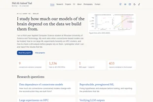</a> | <a href="home-desktop-dark.webp">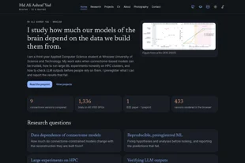</a> | <a href="home-mobile-light.webp">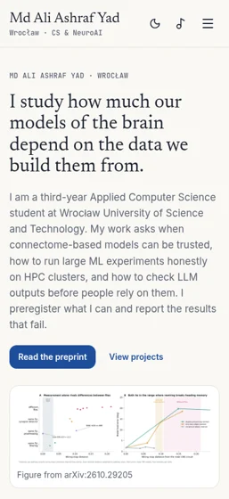</a> | <a href="home-mobile-dark.webp">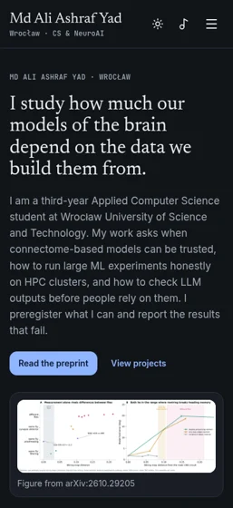</a> |
| Research | <a href="research-desktop-light.webp">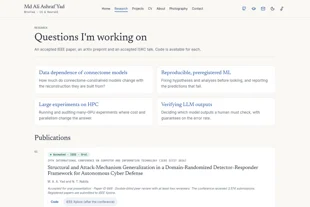</a> | <a href="research-desktop-dark.webp">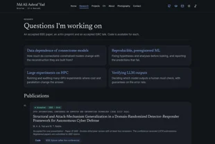</a> | <a href="research-mobile-light.webp">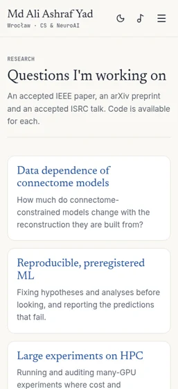</a> | <a href="research-mobile-dark.webp">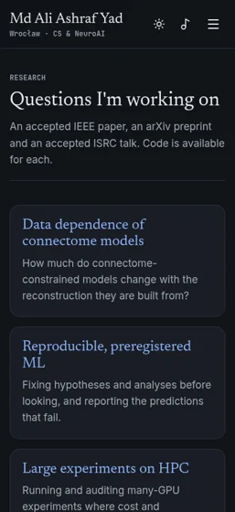</a> |
| Cyber-defense generalisation | <a href="project-desktop-light.webp">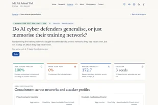</a> | <a href="project-desktop-dark.webp">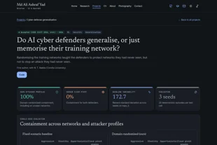</a> | <a href="project-mobile-light.webp">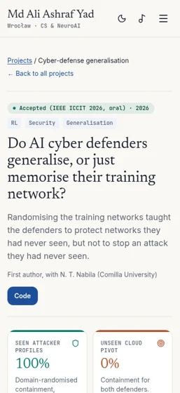</a> | <a href="project-mobile-dark.webp">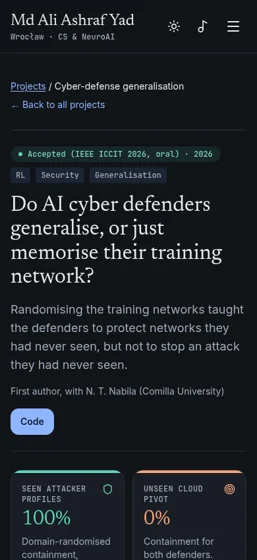</a> |

## Checks

- Lint, production build, and content guard passed after each of the five steps.
- Axe found zero violations across 20 route, viewport, and theme checks, including the CV and ISRC credit. Browser checks also verified publication order, the disabled Xplore pill and the accessible chart tables. [Axe output](axe.json)
- The production bundle passed the updated content guard. A temporary fixture demonstrated that both forms of the old author credit are rejected. [Guard output](guard.txt)
