# Photography gallery and music player

Photography is in the desktop and mobile navigation. The gallery and header player are ready for Ali’s originals and licensed recordings. Both production manifests ship empty. The gallery shows “Photos coming soon,” and the music control appears when a track is available.

## Screenshots

The populated views use synthetic fixture images and a locally generated tone in a separate build. The screenshots are review evidence. The fixture files and manifests are excluded from the branch.

| View | Desktop light | Desktop dark | Mobile light | Mobile dark |
| --- | --- | --- | --- | --- |
| Empty gallery | <a href="empty-gallery-desktop-light.webp">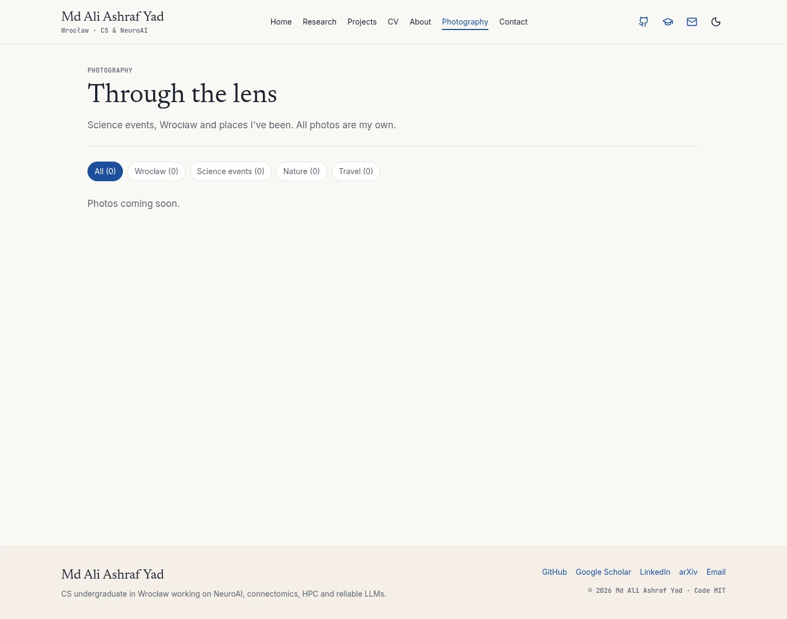</a> | <a href="empty-gallery-desktop-dark.webp">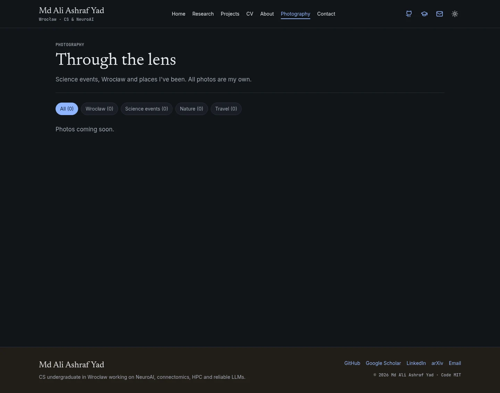</a> | <a href="empty-gallery-mobile-light.webp">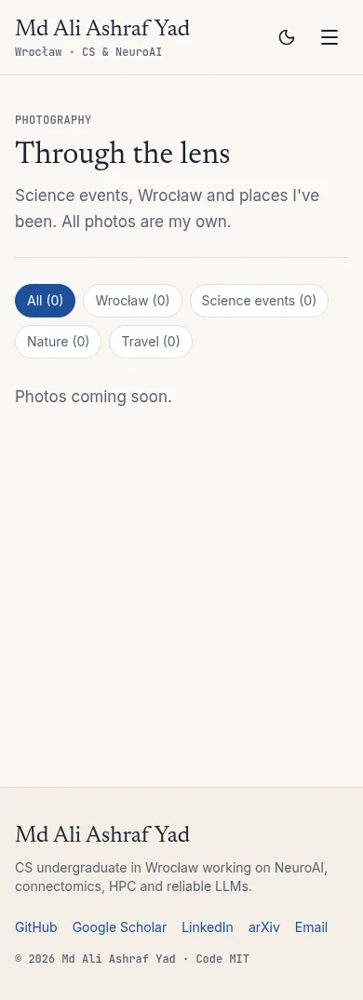</a> | <a href="empty-gallery-mobile-dark.webp">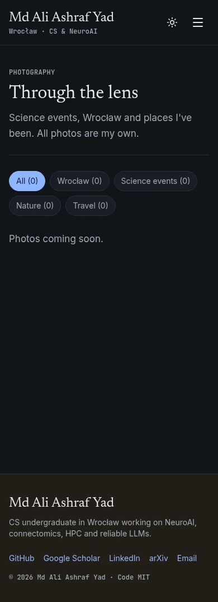</a> |
| Gallery with fixtures | <a href="gallery-desktop-light.webp">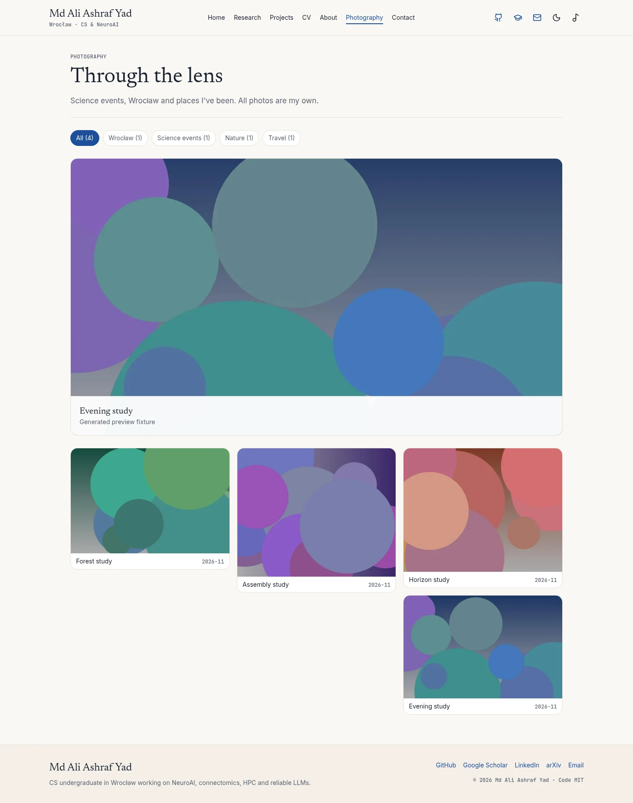</a> | <a href="gallery-desktop-dark.webp">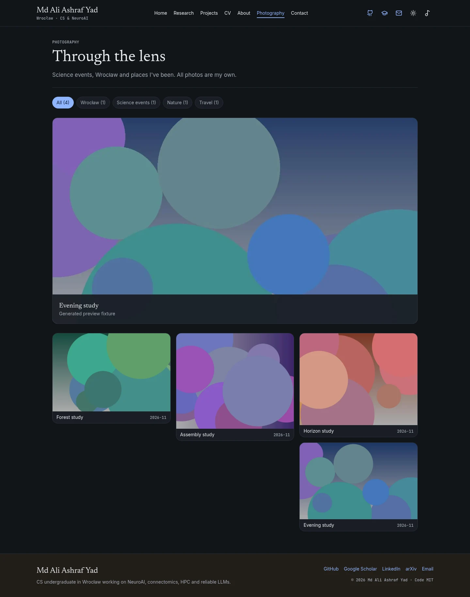</a> | <a href="gallery-mobile-light.webp">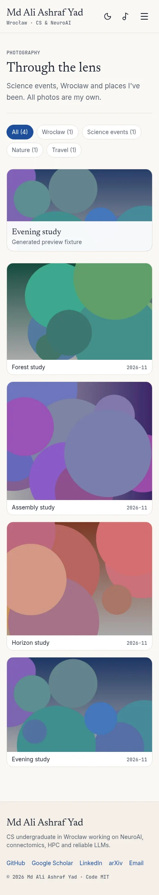</a> | <a href="gallery-mobile-dark.webp">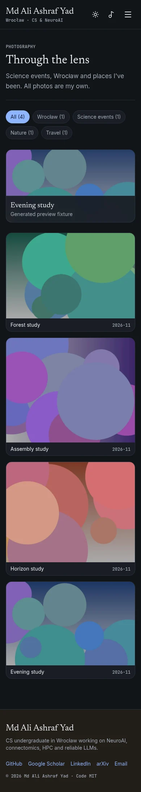</a> |
| Lightbox | <a href="lightbox-desktop-light.webp">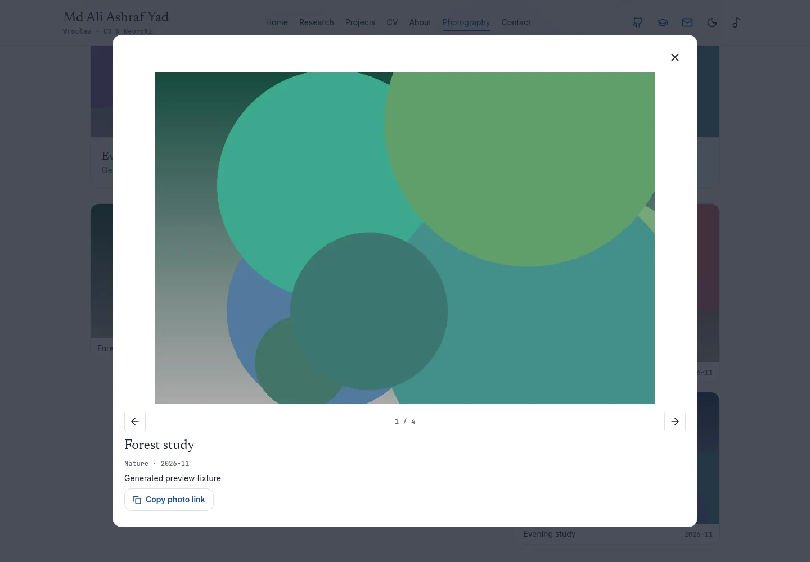</a> | <a href="lightbox-desktop-dark.webp">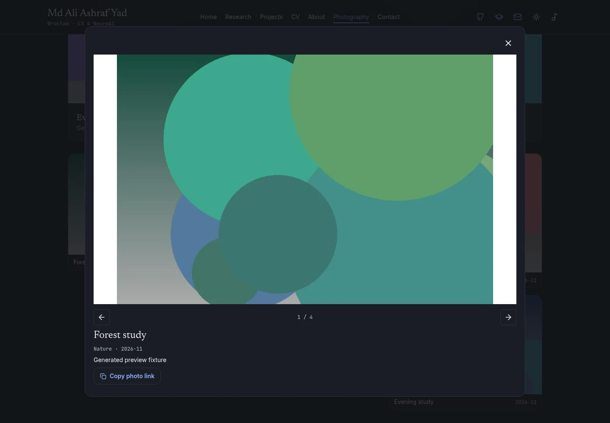</a> | <a href="lightbox-mobile-light.webp">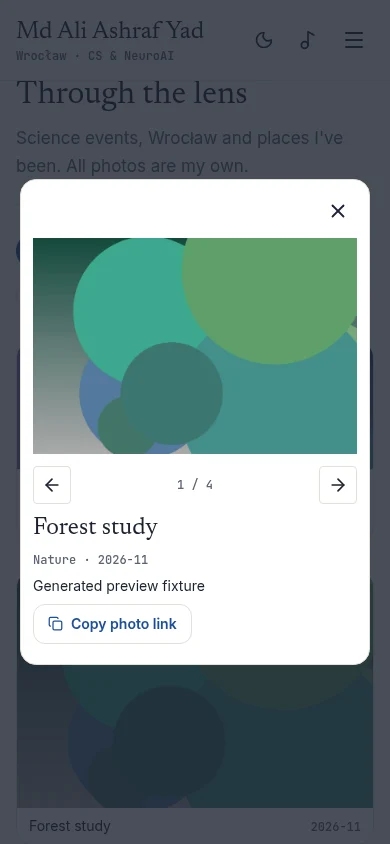</a> | <a href="lightbox-mobile-dark.webp">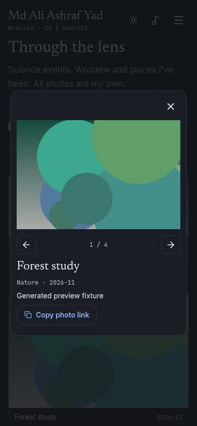</a> |
| Open music player | <a href="music-desktop-light.webp">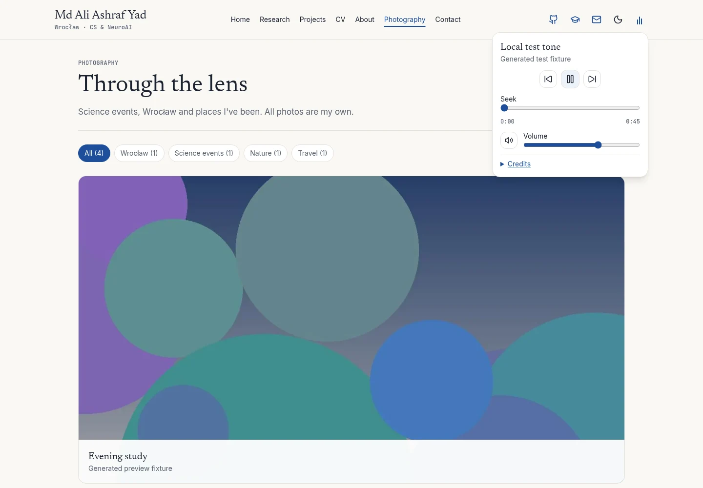</a> | <a href="music-desktop-dark.webp">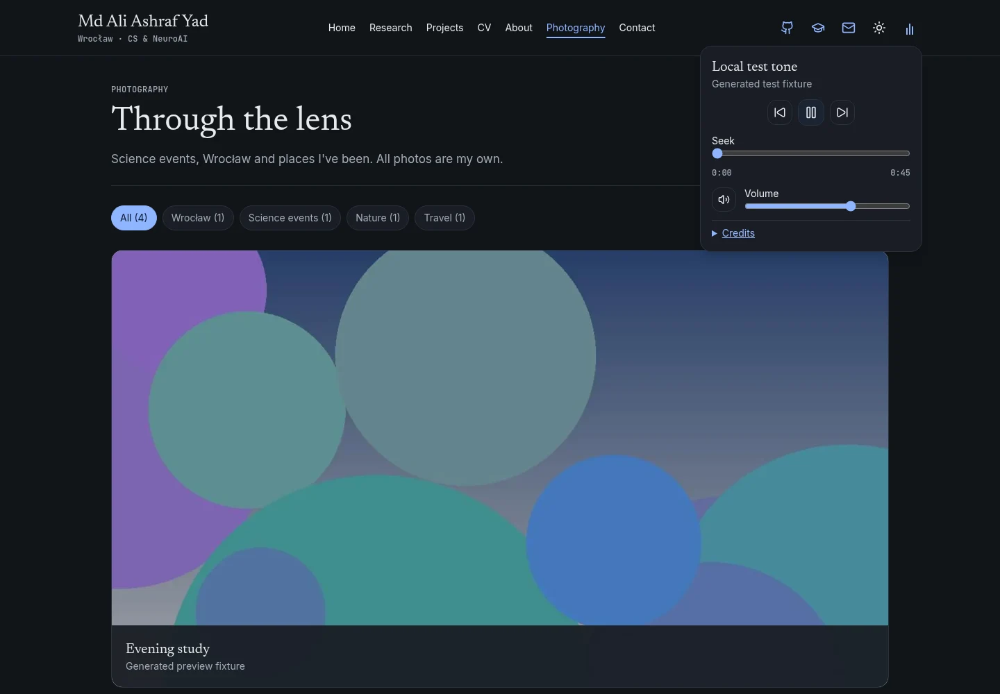</a> | <a href="music-mobile-light.webp">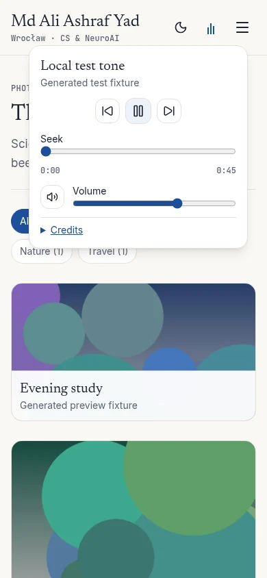</a> | <a href="music-mobile-dark.webp">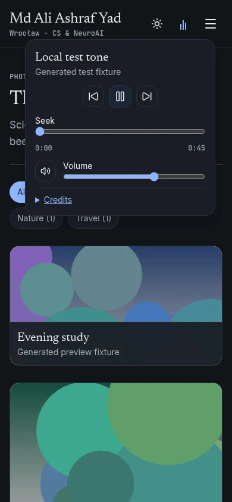</a> |

## Verification

- Lint, production build, and the content guard passed. The legacy corrupted JPEGs were already absent from public/.
- Separate source fixtures verified EXIF orientation, eight WebP sizes with metadata removed, and preservation of captions and alt text on rebuild. Negative controls caught a corrupt original, a metadata-bearing public photo, leaked originals, an unsupported license, and missing CC BY attribution.
- Axe reported zero violations across 24 combinations of viewport, theme, and state. Browser checks covered URL filters and direct photo links, focus restoration, arrow keys, Escape, swipe, the About teaser, playback across route changes, the live announcement, a playlist loop, volume and mute persistence, and hiding the player when the only track fails. Opening the popover made zero MP3 requests. [Populated axe results](axe-fixture.json) · [Empty-state axe results](axe-empty.json)

| Mobile Lighthouse | Performance | Accessibility | Best Practices | SEO |
| --- | ---: | ---: | ---: | ---: |
| Home | 93 | 100 | 100 | 100 |
| Photography | 98 | 100 | 100 | 100 |
| Fly Connectome | 90 | 100 | 100 | 100 |
| BudgetAware-HPO | 94 | 100 | 100 | 100 |

## How to add photos

1. Put original images in photos/originals/wroclaw/, science-events/, nature/, or travel/. Originals are outside the site build. A public repository still exposes any originals committed to it.
2. Run npm run build to regenerate the WebPs and src/data/photos.json.
3. Edit title, caption, alt, date, and featured in the manifest. Add alt text before publishing. Future builds preserve those fields. Commit the source files you intend to share and the updated manifest.

## How to add music

Place each redistributable MP3 under public/music/ and add src, title, artist, license, and source in src/data/music.json. Use own, CC0, CC-BY-4.0, or Pixabay Content License. Enter a source URL, or own recording for your own track. The Credits panel displays the attribution. [Music instructions](../../public/music/README.md)
